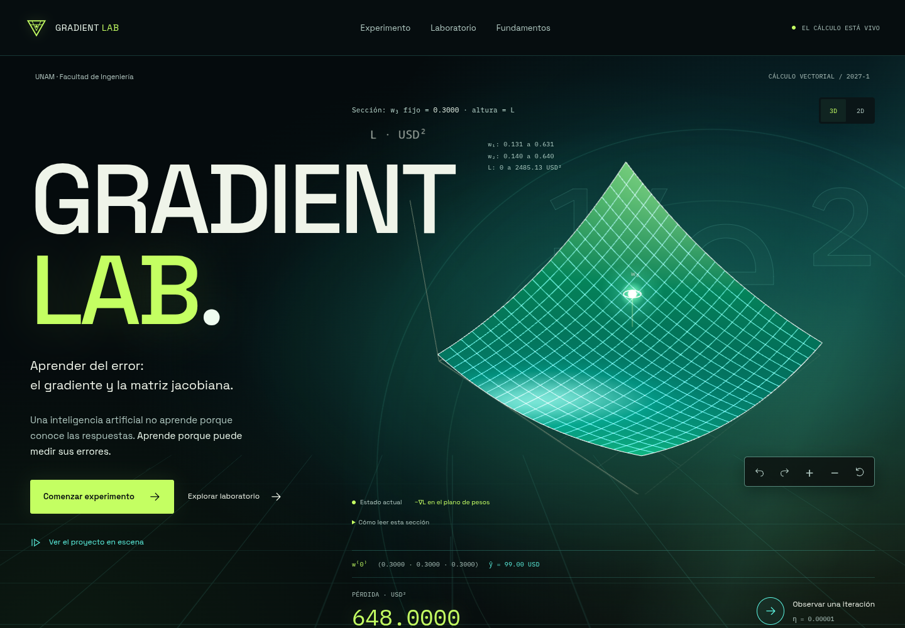

# Gradient Lab

**Aprender del error: el gradiente y la matriz jacobiana.**

Laboratorio educativo en español de Hanniel Cardoso Jaramillo y Angel Joseph Estrada Santos. UNAM, Facultad de Ingeniería, Cálculo Vectorial, Grupo 13, semestre 2027-1. Proyecto estudiantil independiente; no es un sitio oficial de la UNAM.

Una neurona lineal, siete capítulos interactivos y un laboratorio abierto permiten seguir el camino desde la predicción hasta la actualización simultánea de sus tres pesos. Todos los resultados se calculan en el navegador.

[Abrir Gradient Lab](https://hanndev2.github.io/gradient-lab/) · [Repositorio público](https://github.com/HannDev2/gradient-lab)

Esta rama contiene **Gradient Lab 3.0 — Electric Observatory**, con una presentación cinematográfica de todo el proyecto. Se entrega para revisión hacia `feature/visual-v2`; el enlace público conserva la v1. [Informe de trabajo y estado actual](docs/ESTADO_ACTUAL.md) · [Plan y comparación v3](docs/VISUAL_V3.md) · [PR #2 hacia v2](https://github.com/HannDev2/gradient-lab/pull/2) · [Vídeo de la experiencia](docs/visual-v3/after/video/presentation.webm).



## La experiencia

El recorrido permite destapar el objetivo, inspeccionar contribuciones, construir la jacobiana, comprobar la regla de la cadena y aplicar un ajuste simultáneo. En el laboratorio se pueden editar pesos, tasa y datos, ejecutar pasos o lotes y reproducir el entrenamiento con pausa.

La portada abre con una secuencia de 2.6 segundos, una superficie emisiva y retículas espaciales. «Ver el proyecto en escena» inicia diez escenas: introducción, siete capítulos, entrenamiento real y conclusiones con créditos. Flechas para navegar, reproducción opcional, Espacio para pausar, Escape para salir y pantalla completa opcional. El modo académico anterior sigue disponible. La candidata añade «Demostrar el cartel» y «Demostrar divergencia», con parámetros originales en una demostración temporal que conserva tu laboratorio; las ayudas reservan espacio y los pesos muestran el valor completo al editar. [Medidas, capturas y validación manual de la candidata](docs/VISUAL_V3_RC.md).

Gráficas, historial, jacobiana, gradiente y escena 3D comparten un solo estado. La superficie es una sección real de la pérdida con w₃ fijo; el historial sobre ella se etiqueta como proyección. Hay curvas de nivel 2D cuando no hay WebGL, controles de cámara por teclado y soporte para movimiento reducido.

El ejemplo reproduce 99 → 112.14 de predicción y 648 → 261.2898 de pérdida: 59.68 % menos en una iteración. Esos valores se calculan, no se fijan en la interfaz.

## Tecnologías y verificación

Vite, React, TypeScript estricto, Three.js y React Three Fiber, SVG, CSS propio y fuentes locales. Vitest: 33 pruebas del motor, estado y geometría. Playwright: 54 comprobaciones en escritorio y móvil emulado, incluida accesibilidad automatizada con Axe. Resultados y métricas en el informe. Build estático; sin backend ni API de IA. La v3 no añade dependencias.

Skills empleadas: Ponytail para alcance, Impeccable como guía visual principal, Animate para movimiento explicativo, planificación/TDD/verificación y revisión independiente de código. Decisiones y límites se detallan en la documentación.

## Desarrollo

Node.js 22.12 o posterior.

```sh
npm ci
npm run dev
```

Abre `http://127.0.0.1:5173/gradient-lab/`. Presentación: `http://127.0.0.1:5173/gradient-lab/#/presentacion`. Conserva la terminal abierta y pulsa Ctrl+C para detener el servidor. Si estás en la raíz del workspace original, entra primero con `cd gradient-lab`.

Para verificar y servir la compilación:

```sh
npm test
npm run test:e2e
npm run build
npm run preview
```

La configuración de Pages usa `/gradient-lab/`. Las rutas hash funcionan al recargar sin servidor de aplicación.

## Fuentes y documentación

- [Cartel original](docs/Cartel.pdf), incorporado y leído como fuente principal.
- [Plan y criterios](docs/PLAN.md).
- [Especificación matemática](docs/MATH_SPEC.md).
- [Sistema visual](docs/DESIGN_SYSTEM.md).
- [Decisiones y skills](docs/DECISIONS.md).
- [Informe de verificación](docs/VERIFICATION.md).
- [Informe de trabajo y estado actual](docs/ESTADO_ACTUAL.md).
- [Evolución visual v2 y capturas comparativas](docs/VISUAL_V2.md).
- [Electric Observatory: contrato, capturas y verificación v3](docs/VISUAL_V3.md).
- [Mantenimiento y publicación](docs/MAINTENANCE.md).
- [Guion de demostración de 4 minutos](docs/DEMO.md).

Los precios son hipotéticos, en USD. Este ejemplo no demuestra capacidad predictiva financiera ni generalización. No se reproducen logotipos de terceros en la interfaz. La elección de una licencia para el trabajo original queda pendiente de los autores.

El módulo 3D se descarga bajo demanda (~252 kB gzip); la presentación también se carga por separado. El historial se limita a 1000 pasos y se detiene ante divergencia extrema. Las pruebas móviles son emuladas; no se ha hecho una auditoría manual con lector de pantalla ni se certifican FPS en GPU física. Estado y evidencia de publicación: `docs/VERIFICATION.md`.
