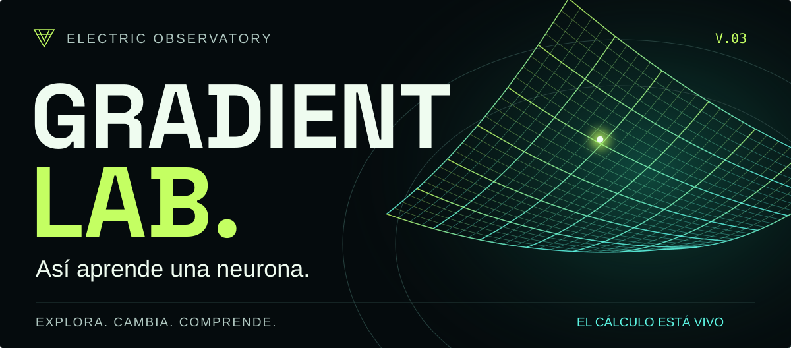
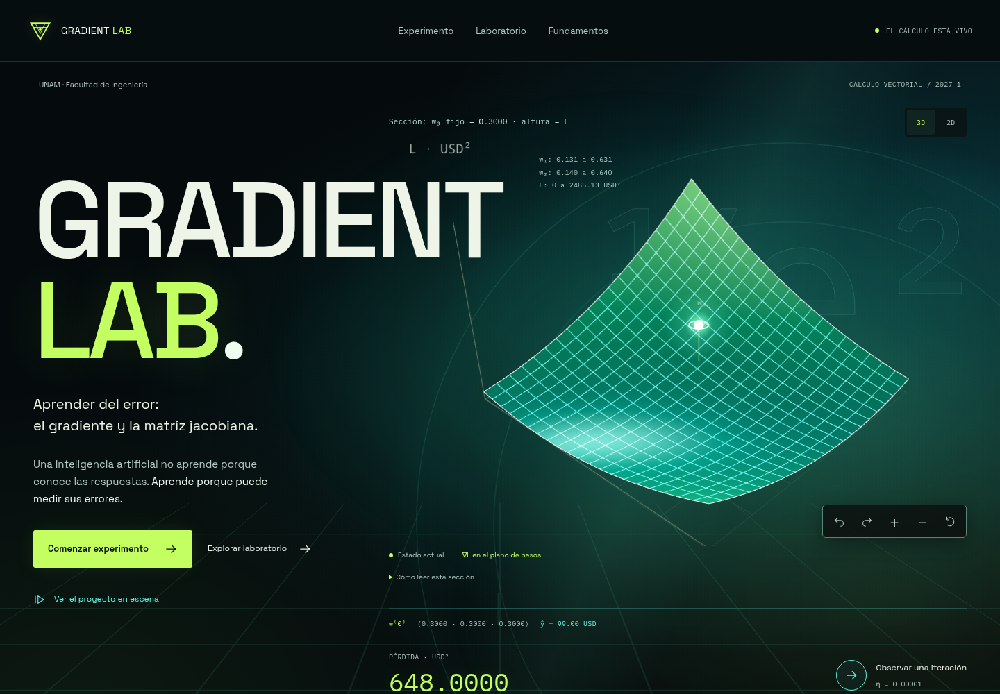
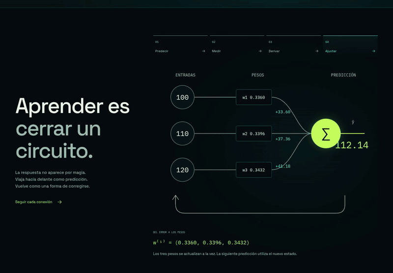
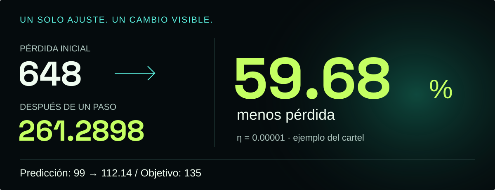
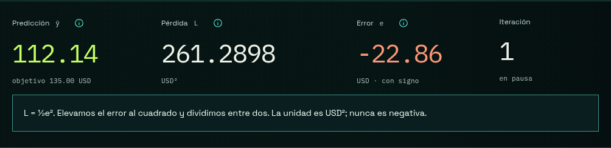
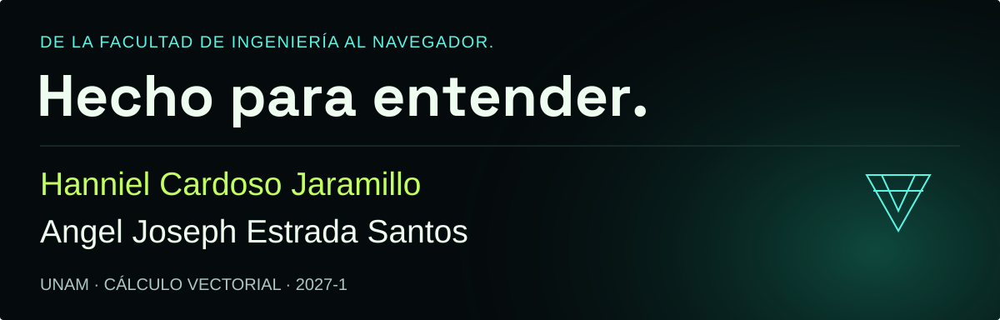

<a href="https://hanndev2.github.io/gradient-lab/">
  
</a>

<p align="center">
  <a href="https://hanndev2.github.io/gradient-lab/"><strong>Entrar al proyecto ↗</strong></a> &nbsp; · &nbsp;
  <a href="https://hanndev2.github.io/gradient-lab/#/presentacion">Ver la presentación</a> &nbsp; · &nbsp;
  <a href="https://hanndev2.github.io/gradient-lab/#/laboratorio">Experimentar</a> &nbsp; · &nbsp;
  <a href="#ejecutarlo-en-tu-equipo">Ejecutarlo en tu equipo</a>
</p>

# Aprender del error.

**Gradient Lab convierte el aprendizaje de una neurona en algo que puedes ver, tocar y entender.** Dale tres datos, observa su respuesta y descubre cómo ajusta sus tres pesos para acercarse a un objetivo. Cada cambio aparece en los números, las gráficas y un paisaje tridimensional del error.

Puedes comenzar sin saber cálculo ni inteligencia artificial: el recorrido construye la explicación paso a paso, desde una predicción hasta el gradiente y la matriz jacobiana. Si ya conoces el tema, abre el laboratorio y pon las fórmulas a prueba.

Creado por **Hanniel Cardoso Jaramillo** y **Angel Joseph Estrada Santos** · UNAM, Facultad de Ingeniería.

<a href="https://hanndev2.github.io/gradient-lab/">
  
</a>

<p align="center"><sub>Electric Observatory · Gradient Lab 3.0 · Interactivo, en español y directamente en tu navegador.</sub></p>

## Una idea. Tres maneras de descubrirla.

**01 / Sigue la historia.** Siete capítulos para descubrir qué entra en una neurona, cómo se forma una predicción, cuánto se equivoca y cómo encuentra una dirección para mejorar. Las fórmulas se construyen con interacciones.

**02 / Haz tu propio experimento.** Cambia datos, pesos y tasa de aprendizaje. Avanza un paso, ejecuta un lote o reproduce el entrenamiento. Observa cómo converger, oscilar o divergir cambia el mismo paisaje y sus gráficas.

**03 / Pon el proyecto en escena.** Diez escenas conectan la intuición, el cálculo y una demostración en vivo. Presenta el caso del cartel o su contraste divergente; las demostraciones conservan tu laboratorio personalizado.

<a href="https://hanndev2.github.io/gradient-lab/#/presentacion">
  <picture>
    <source media="(prefers-reduced-motion: reduce)" srcset="docs/visual-v3/after/cinema-jacobian-1440.png">
  
  </picture>
</a>

<p align="center"><sub>Fragmento de una grabación real del recorrido V3. <a href="docs/visual-v3/after/video/presentation.webm">Ver el vídeo completo</a> · <a href="docs/visual-v3/after/cinema-jacobian-1440.png">Ver una captura estática</a>.</sub></p>

## Lo que cambia en un solo paso

El ejemplo empieza con una respuesta de **99** y un objetivo de **135**. La neurona mide su error y ajusta simultáneamente los tres pesos. Su siguiente respuesta es **112.14**: está más cerca del objetivo.



La **pérdida** mide cuánto se equivoca el modelo; aquí es la mitad del error al cuadrado. El **gradiente** indica cómo cambia esa pérdida al mover cada peso. Dar un paso en la dirección contraria permite reducirla con una tasa adecuada. Una tasa demasiado grande puede hacerla crecer: también puedes comprobarlo.

En la aplicación, estas cifras se calculan con el estado actual. El gráfico anterior resume el ejemplo original del [cartel](docs/Cartel.pdf).

<details>
<summary><strong>Ver las matemáticas detrás de la escena</strong></summary>

Con tres entradas $x$, tres pesos $w$ y un objetivo $y$:

$$
\begin{aligned}
\hat y &= w^\mathsf{T}x \\
e &= \hat y-y \\
L &= \frac{1}{2}e^2
\end{aligned}
$$

La jacobiana reúne la sensibilidad de la predicción respecto de cada peso. La regla de la cadena produce el gradiente y una única actualización simultánea:

$$
\begin{aligned}
J &= x^\mathsf{T} \\
\nabla_w L &= J^\mathsf{T}e \\
w_{t+1} &= w_t - \eta\nabla_w L
\end{aligned}
$$

El caso del cartel usa $x=(100,110,120)$, $w=(0.3,0.3,0.3)$, $y=135$ y $\eta=0.00001$. Los nuevos pesos son $(0.3360,0.3396,0.3432)$.

La escena 3D representa una **sección de la pérdida con el tercer peso fijo**: un valle parabólico con una dirección plana. El historial sobre esa sección se identifica como proyección; la gráfica temporal conserva las pérdidas originales.

[Especificación matemática y estabilidad →](docs/MATH_SPEC.md)

</details>

## Un paisaje que también es un instrumento

Las gráficas, la jacobiana, el gradiente y la escena comparten el mismo estado matemático. Mover un control cambia el experimento completo. El color y la altura de la superficie corresponden a la pérdida calculada.

<a href="https://hanndev2.github.io/gradient-lab/#/laboratorio">
  
</a>

- **Control del experimento:** edición precisa, pausa, pasos, lotes, reinicio e historial de hasta 1000 pasos.
- **Explicaciones donde hacen falta:** ayudas para predicción, error y pérdida, además de fundamentos y cartel original.
- **Acceso al contenido:** teclado, movimiento reducido y curvas de nivel 2D cuando WebGL no está disponible.
- **Cálculo local:** sin cuentas, backend ni API de IA. Los experimentos se ejecutan en el navegador.

## Ejecutarlo en tu equipo

Necesitas **Node.js 22.12 o posterior**.

```sh
git clone https://github.com/HannDev2/gradient-lab.git
cd gradient-lab
npm ci
npm run dev
```

Abre **http://127.0.0.1:5173/gradient-lab/**. Para compartirlo sin instalar nada, usa el [sitio público](https://hanndev2.github.io/gradient-lab/).

<details>
<summary><strong>Stack, pruebas y publicación</strong></summary>

**React 19 · TypeScript estricto · Vite · Three.js · React Three Fiber · SVG · CSS.** Fuentes locales: Space Grotesk e IBM Plex Mono. La escena 3D y la presentación se descargan bajo demanda.

```sh
npm test                       # Motor, estado, geometría y precisión
npm run build                  # TypeScript + compilación de producción
npx playwright install chromium
npm run test:e2e                # Experiencia, WebGL y accesibilidad
npm run preview                # Servir el build localmente
```

La suite contiene **33 pruebas unitarias** y **54 comprobaciones de navegador**, entre escritorio y móvil emulado, con análisis de accesibilidad mediante Axe. La evidencia y sus límites están en el [informe de verificación](docs/VERIFICATION.md).

Cada push a `main` ejecuta las comprobaciones y publica en GitHub Pages después de aprobarlas. Los pull requests se verifican sin desplegar. Base pública: `/gradient-lab/`; las rutas hash permiten recargar las vistas sin un servidor de aplicación.

[](https://github.com/HannDev2/gradient-lab/actions/workflows/deploy.yml)

[Mantenimiento y publicación →](docs/MAINTENANCE.md)

</details>

## Para mirar más de cerca

| Si quieres… | Abre |
| --- | --- |
| Entender las fórmulas y sus límites | [Especificación matemática](docs/MATH_SPEC.md) |
| Consultar la fuente del ejemplo | [Cartel original](docs/Cartel.pdf) |
| Preparar una exposición | [Guion de demostración](docs/DEMO.md) |
| Explorar la identidad visual | [Sistema de diseño](docs/DESIGN_SYSTEM.md) · [Electric Observatory](docs/VISUAL_V3.md) |
| Revisar resultados y comprobaciones | [Verificación](docs/VERIFICATION.md) · [Refinamiento V3](docs/VISUAL_V3_RC.md) |
| Continuar el proyecto | [Plan](docs/PLAN.md) · [Estado actual](docs/ESTADO_ACTUAL.md) · [Decisiones](docs/DECISIONS.md) |

Este experimento usa una neurona lineal sin sesgo y una sola observación con precios hipotéticos en USD. Sirve para estudiar el aprendizaje; no demuestra predicción financiera ni generalización. Las pruebas móviles son emuladas; quedan pendientes dispositivos físicos y una auditoría manual con lector de pantalla. La licencia del trabajo original está pendiente de decisión de sus autores.



**Hanniel Cardoso Jaramillo · Angel Joseph Estrada Santos**

Cálculo Vectorial · Grupo 13 · Semestre 2027-1 · Facultad de Ingeniería, UNAM.

Proyecto estudiantil independiente; no es un sitio oficial de la UNAM.

<p align="center"><a href="https://hanndev2.github.io/gradient-lab/"><strong>El siguiente paso lo das tú. Abrir Gradient Lab ↗</strong></a></p>
